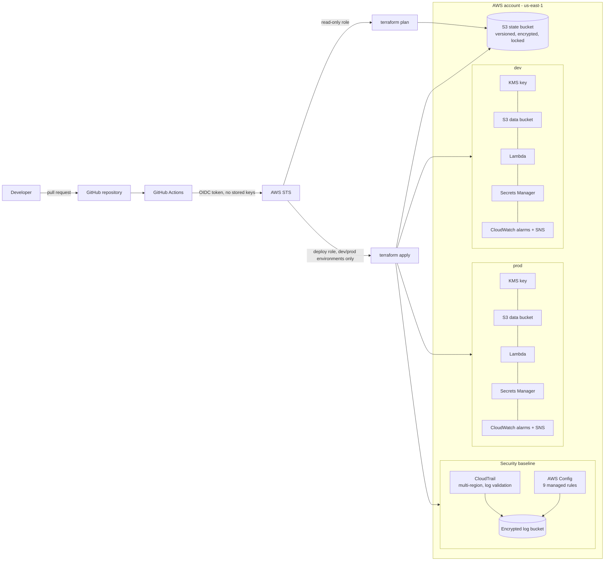
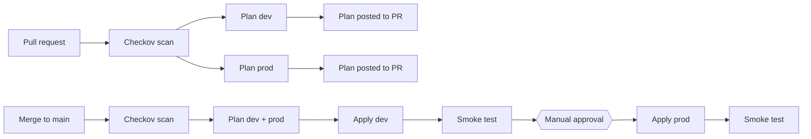

# Secure AWS Platform

A multi-environment AWS platform built entirely with **Terraform** and deployed through a **GitHub Actions** pipeline that uses **keyless OIDC authentication**, **automated security scanning**, **plan previews on pull requests**, and an **approval gate before production**.

The account is protected by a security baseline: **CloudTrail** audit logging and **AWS Config** compliance rules. Every resource is encrypted with **customer-managed KMS keys** and access follows **least privilege**.

   

---

## Architecture



## How the pipeline works



| Stage | What happens | AWS identity |
|---|---|---|
| Security scan | Checkov scans all Terraform for misconfigurations | None needed |
| Plan | `fmt -check`, `validate`, `plan` for dev and prod; plan posted as a PR comment | Read-only role |
| Apply dev | Runs automatically after merge, then a Lambda smoke test | Deploy role via `dev` environment |
| Apply prod | Waits for a reviewer to approve in GitHub, then deploys and smoke-tests | Deploy role via `prod` environment |

## Security features

| Area | Implementation |
|---|---|
| **No stored credentials** | GitHub Actions authenticates with OIDC and receives short-lived credentials. No AWS keys exist in GitHub. |
| **Least privilege** | Separate **read-only plan role** and **deploy role**. The deploy role trusts only the protected `dev` and `prod` GitHub environments. The Lambda role can access only its own bucket, secret, key and log group. |
| **Pinned trust** | IAM trust policies match GitHub's immutable subject claims, which include numeric owner and repository IDs, protecting against repository renaming or takeover. |
| **Encryption** | Customer-managed KMS keys with automatic rotation for S3, Secrets Manager, CloudWatch Logs, SNS, Lambda environment variables, CloudTrail and Config. |
| **Secrets** | Generated by Terraform and stored in Secrets Manager. The application reads them at runtime; nothing is hard-coded. |
| **S3 hardening** | Public access fully blocked, HTTPS-only bucket policies, versioning, lifecycle rules. |
| **Audit logging** | Multi-region CloudTrail with log file validation, encrypted with KMS. |
| **Continuous compliance** | AWS Config rules: S3 public access, S3 encryption, S3 HTTPS-only, KMS rotation, CloudTrail enabled, log file validation, Lambda public access, root access keys, root MFA. |
| **Shift-left scanning** | Checkov runs on every pull request. Accepted risks are documented inline with `#checkov:skip` and a written reason. |
| **Safe state** | Remote S3 backend with encryption, versioning, S3-native locking and separate state per environment. |
| **Release safety** | Production deploys require dev to pass its smoke test and a human approval. |

## Repository structure

```
.
├── .github/workflows/terraform.yml   # CI/CD pipeline
├── bootstrap/                        # One-time setup: state bucket + GitHub OIDC roles
├── modules/
│   ├── platform/                     # Reusable environment: KMS, S3, Secrets Manager, Lambda, alarms
│   │   └── lambda_src/handler.py     # Health-check function
│   └── security-baseline/            # CloudTrail + AWS Config + encrypted log bucket
└── envs/
    ├── dev/                          # Uses the platform module with dev settings
    └── prod/                         # Uses the platform module with prod settings + security baseline
```

## Deploying it yourself

**Prerequisites:** Terraform 1.10+, AWS CLI configured with an IAM user (not root), a GitHub repository.

1. **Bootstrap (once, from your machine):** set `github_owner`, `github_repo`, `github_owner_id` and `github_repo_id` in `bootstrap/variables.tf`, then:
   ```bash
   cd bootstrap
   terraform init && terraform apply
   ```
2. **Update** the state bucket name in `envs/*/backend.tf` and the role ARNs in `.github/workflows/terraform.yml` using the bootstrap outputs.
3. **Create GitHub environments:** `dev`, and `prod` with **required reviewers**.
4. **Open a pull request.** The pipeline scans and plans; merge to deploy dev, then approve prod.

## Problems I solved

**OIDC login rejected by AWS.** The pipeline failed with `Not authorized to perform sts:AssumeRoleWithWebIdentity`. I added a temporary step to decode the token's claims and found GitHub was sending its newer immutable subject format (`repo:owner@<owner-id>/repo@<repo-id>:...`). I updated the IAM trust policies to accept it, which also pins trust to the repository's permanent IDs.

**Lambda concurrency limit on a new account.** Reserving concurrency failed because new AWS accounts allow only 10 concurrent executions, all of which must remain unreserved. I removed the reservation and documented the trade-off in code, to be restored once the quota is raised.

**False failure in the smoke test.** The deployment succeeded but the smoke test failed, because the Lambda response body is escaped JSON and a plain text search didn't match it. I replaced the search with `jq` parsing (`.body | fromjson | .status`) and shipped the fix through a pull request.

**Root access key detected by AWS Config.** The `iam-root-access-key-check` rule flagged an active root access key that the local CLI depended on. I moved the CLI to an IAM user, confirmed Terraform still worked, then deactivated and removed the root key.

**Large provider binary blocked a push.** An early commit included the 685 MB Terraform provider and state files. I rewrote the commit, fixed `.gitignore` (which had been saved in an encoding Git couldn't read) and verified it with `git check-ignore`.

## What I'd do next in production

- Replace the deploy role's `AdministratorAccess` with a custom policy scoped to the services this project uses.
- Add automatic **secret rotation** with a rotation Lambda.
- Send CloudTrail to **CloudWatch Logs** with metric filters and alarms for root logins and IAM policy changes.
- Add **S3 access logging** and enable **GuardDuty** and **Security Hub**.
- Move dev and prod into **separate AWS accounts** under AWS Organizations, with service control policies.
- Add **tflint**, **Infracost** cost estimates on pull requests, and drift detection on a schedule.
- Put the Lambda in a VPC with VPC endpoints if it needs to reach private resources.

## Cost

About **$5–6 per month** with dev, prod and the security baseline running: mainly KMS keys (~$1 each), Secrets Manager (~$0.40 per secret) and AWS Config evaluations. CloudTrail's first management trail is free, and Lambda, SNS and CloudWatch stay within the free tier. Run `terraform destroy` in an environment folder to stop its costs.

## Screenshots

| Pipeline: dev → approval → prod | Plan comment on a pull request |
|---|---|
|  |  |

| AWS Config compliance |
|---|
|  |

## Skills demonstrated

Terraform (modules, remote state, locking, `for_each`, conditionals, validation) · AWS (IAM, STS/OIDC, KMS, S3, Lambda, Secrets Manager, CloudWatch, SNS, CloudTrail, AWS Config) · GitHub Actions (matrix jobs, environments, approvals, OIDC) · DevSecOps (Checkov, least privilege, encryption, audit logging, compliance as code) · Python · Troubleshooting
